# Birthdays

<p align="center">
  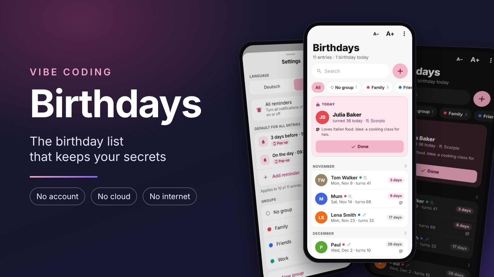
</p>

<p align="center">
  <b>Birthday reminders for Android that stay on your phone.</b><br>
  No account · No cloud · No internet · English and German
</p>

<p align="center">
  <a href="https://github.com/netperformance/birthdayreminder/releases">Download APK</a> ·
  <a href="#english">English</a> ·
  <a href="#deutsch">Deutsch</a> ·
  <a href="LICENSE">MIT License</a>
</p>

## English

### Screenshots

<p align="center">
  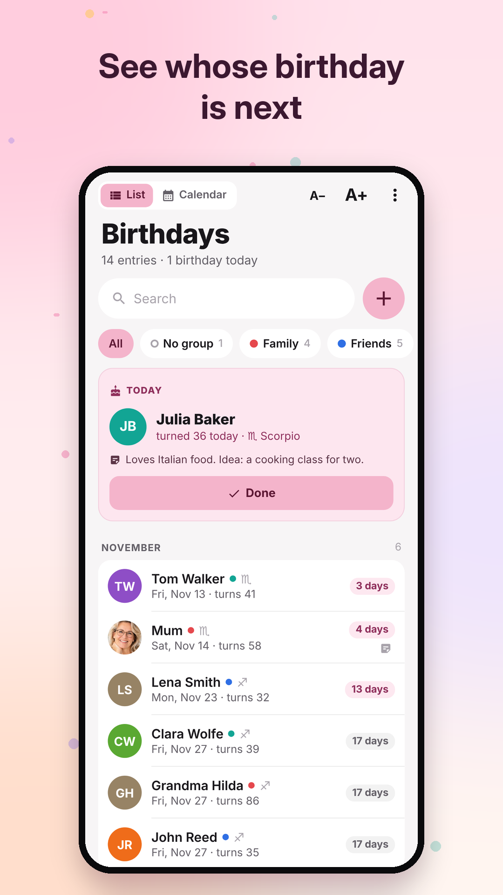
  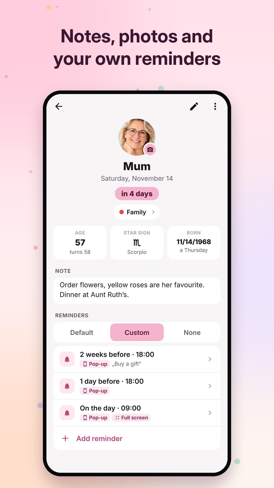
  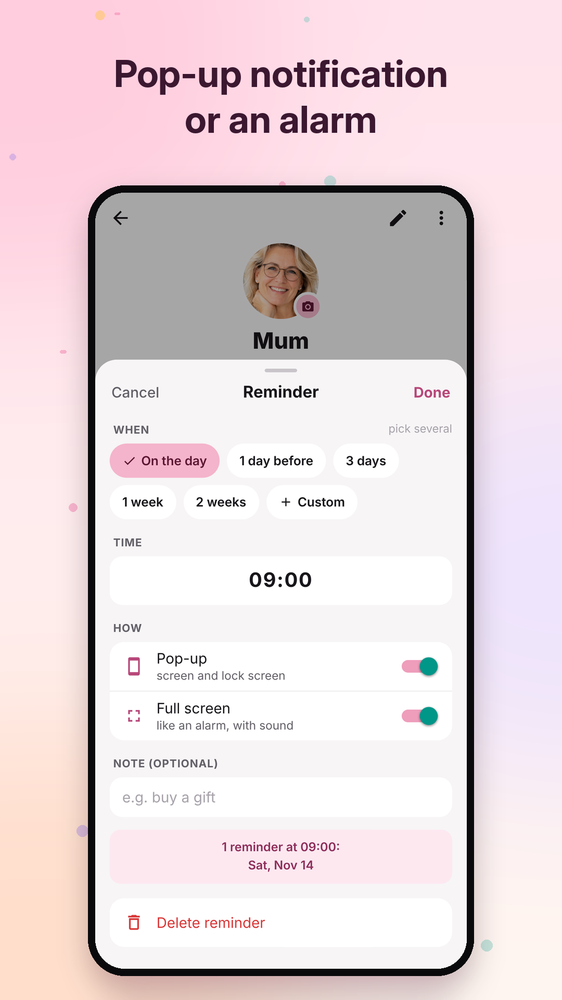
  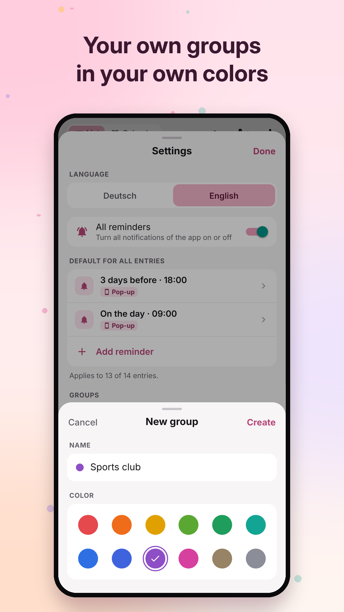
</p>

<p align="center">
  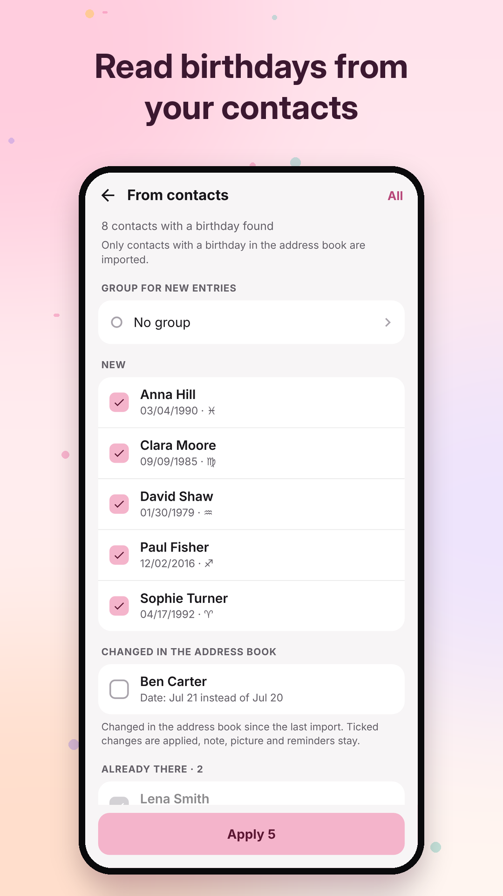
  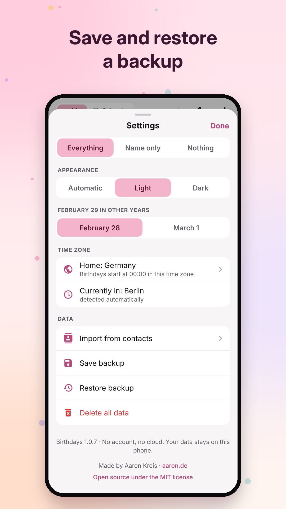
  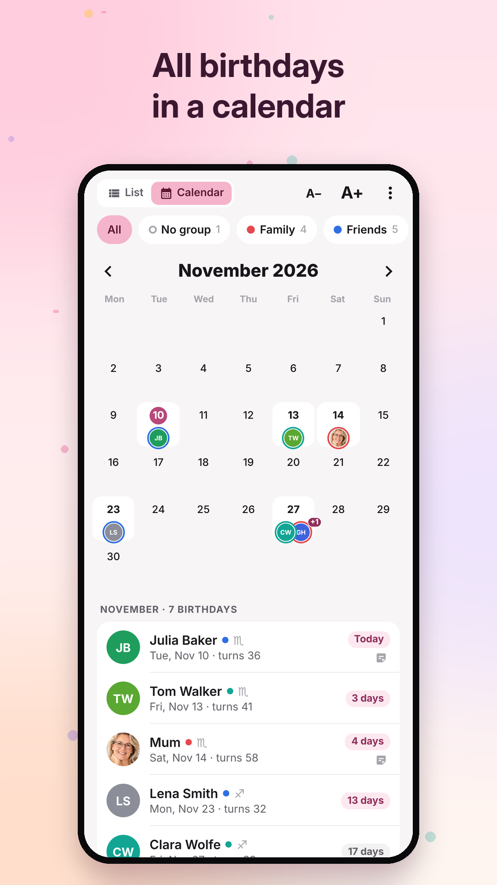
  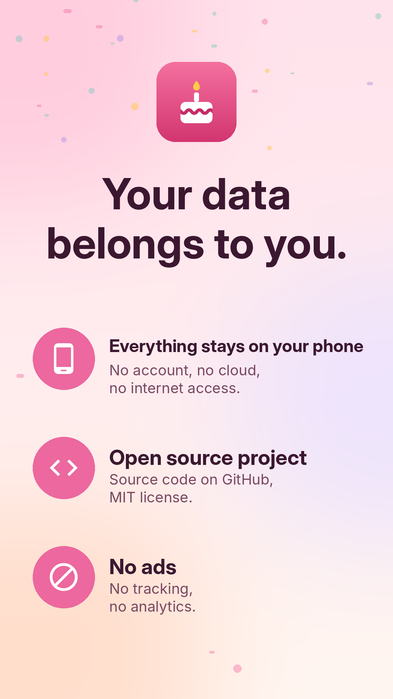
</p>

### About the app

Birthdays keeps the birthdays of your friends and reminds you in time. Each entry has a name, a birthday (the year is optional), a note, a picture and its own reminders. Age and star sign are shown everywhere. All data stays in a database on your phone. The app has no internet permission.

### Features

- **Home screen:** Whoever has a birthday today appears in a card at the top. With several birthdays, swipe the cards or use the arrows, "1 / 3" and the dots show the position. Below, all entries follow by month, starting with the next birthday, with the days left, the age they will turn and the star sign.
- **Calendar:** At the top left you switch between list and calendar, the app remembers the choice. The calendar shows the month, each day with a birthday carries up to two pictures with a ring in the group's color, from three people on "+1". Below are the birthdays of the month. A tapped day shows only its birthdays, an empty day offers "Add an entry on this day". The month name opens the whole year, where birthdays are colored dots, split for several groups. Swipe or use the arrows to change the month. The group filters apply here too.
- **Done:** "Done" on the card, in the notification or on the full screen marks the person for today. No further reminders for this person today. It cannot be undone.
- **New entry:** Name, birthday with a number keyboard that jumps to the next field by itself, year optional ("89" becomes 1989), a preview with weekday, days left, age and star sign, a note and the reminder mode.
- **Entry:** Age, star sign, weekday of birth, note (saved automatically), picture from the gallery, the camera or the contact, and the reminders.
- **Reminders:** per entry "Default" (from the settings), "Custom" or "None". Several distances can be picked at once (on the day, 1 day, 3 days, 1 week, 2 weeks or a custom distance in days, weeks or months). Each reminder has a time, pop-up and/or full screen and an optional short note such as "buy a gift". New reminders start with pop-up only.
- **Pop-up and full screen:** The pop-up appears on the lock screen with "Done" and "In 1 hr" (before the day: "Done" and "Tomorrow"). The full screen appears over the lock screen like an alarm, with sound, until you react. On the lock screen, a notification can show everything, only the name ("Name only") or no name at all ("Nothing", then it only says "Birthday today" or "A birthday is coming up").
- **Pause:** "All reminders" in the settings pauses everything without deleting anything. The home screen then shows a notice that can be closed.
- **Time zones:** A birthday lasts from 00:00 to 24:00 at "home" (or in the time zone of the person). Where the phone is does not matter. When you travel, the card shows both times. In Sydney the card says "Starts soon" until the birthday has started in Germany. Reminders on the day come at the set time of the person, at night (22:00 to 07:00) they move to 07:00 your time. Reminders before the day come at your local time. Time zone changes, daylight saving time, a changed clock and a restart all reschedule the reminders, and a reminder skipped by a flight comes right away as long as the birthday is still on.
- **Groups:** such as Family, Friends or Work, each with one of 12 colors. Every entry is in exactly one group: the fixed group "No group" or one of your own. Chips below the search filter the home screen, "All" shows everyone, and a colored dot behind the name shows the group. The chosen group stays when the app is opened again, and + adds new entries straight to it. Groups only sort and filter, reminders do not depend on them. After installation the app already has the groups No group, Family, Friends and Work (German phones: Ohne Gruppe, Familie, Freunde, Arbeit). New entries and imported contacts go to "No group" unless another group is chosen. Groups are created, renamed, sorted and deleted in the settings. "No group" can only be moved, not renamed or deleted. Deleting a group keeps its entries, they move to "No group".
- **Search:** in names and notes, ignoring case and accents. A month name shows all birthdays in that month.
- **Import from contacts:** reads the birthdays from the Android contacts, as often as you like. Only contacts with a birthday are imported. A repeated import recognizes people by the contact's ID (and by name and birthday as a fallback, because Android sometimes assigns new IDs), so nothing is added twice. Changes made in the address book since the last import (name or date) are listed separately and applied only when ticked. Changes made in the app stay.
- **February 29:** in other years on February 28 or March 1.
- **English and German:** English uses the date order of the phone's region (USA: "Sat, Nov 7", UK and Australia: "Sat 7 Nov") and the 12 or 24 hour setting of Android.
- **Settings:** language, reminders, default reminders, groups, lock screen, appearance, February 29, home time zone, import, save and restore a backup (with pictures), delete all data.

### Permissions

The app asks for each permission only when it is needed:

- **Notifications** for pop-ups (Android 13 and newer).
- **Exact alarms** so reminders come on time. On Android 13 and newer you allow this once in the settings, the app takes you there.
- **Start after reboot** to reschedule the reminders.
- **Full screen** over the lock screen, only for full screen reminders. Android 14 and newer ask once.
- **Battery optimization off** (optional, important on Samsung and Xiaomi). The app opens the list of apps in Android settings, pick Birthdays there.
- **Contacts** only when importing or taking a picture from a contact.
- **Camera** only when taking a photo.
- **Vibration** for the full screen.

No internet, no ads, no tracking, no analytics. Android's automatic cloud backup is turned off (`allowBackup: false`).

### Install the APK

1. Copy the file to your phone (USB cable, or send it to yourself by mail or messenger).
2. Tap it in the Files app on your phone.
3. Android asks whether installing from this source is allowed. Allow it once.
4. Install. The app appears as "Birthdays" with a pink icon.

The APK runs on phones with a 64 bit processor (arm64) from Android 8 on.

### Build your own APK

```
bash scripts/build-apk.sh
```

Runs on Linux or WSL with Node.js 20+ and Java 17 to 21. The signing key lives in `signing/` (listed in `.gitignore`). Keep it safe: Android only installs an update if it is signed with the same key. Before an update, increase `version` and `versionCode` in `app.json`.

For Google Play, `bash scripts/build-apk.sh --play` builds an app bundle (`aab/Birthdays-<version>.aab`) instead of the APK. Google Play signs the app with its own key, so the Play version and the APKs from GitHub cannot update each other: switching means uninstalling first.

### Development

```
npm install
npm test
npm run typecheck
```

| Folder | Content |
|---|---|
| `src/domain/` | data model, calendar, time zones, schedule, star signs, date formats (with tests) |
| `src/data/` | storage: SQLite on the phone, memory for tests |
| `src/store/` | BirthdayStore: the only way to change data, backup (with tests) |
| `src/ui/` | screens, all texts in English and German in `i18n.ts` |
| `modules/birthday-alarms/` | Android module: alarms, notifications, full screen, reboot and time zone changes |
| `modules/keyboard-language/` | keyboard language hint (from My Notes) |

The rules for when a reminder comes exist twice, in `src/domain/schedule.ts` (display, tested) and in `modules/birthday-alarms/.../Planner.kt` (alarms). A change in one needs the same change in the other.

### License

Birthdays is open source under the MIT license, see [LICENSE](LICENSE).

## Deutsch

### Bildschirme

<p align="center">
  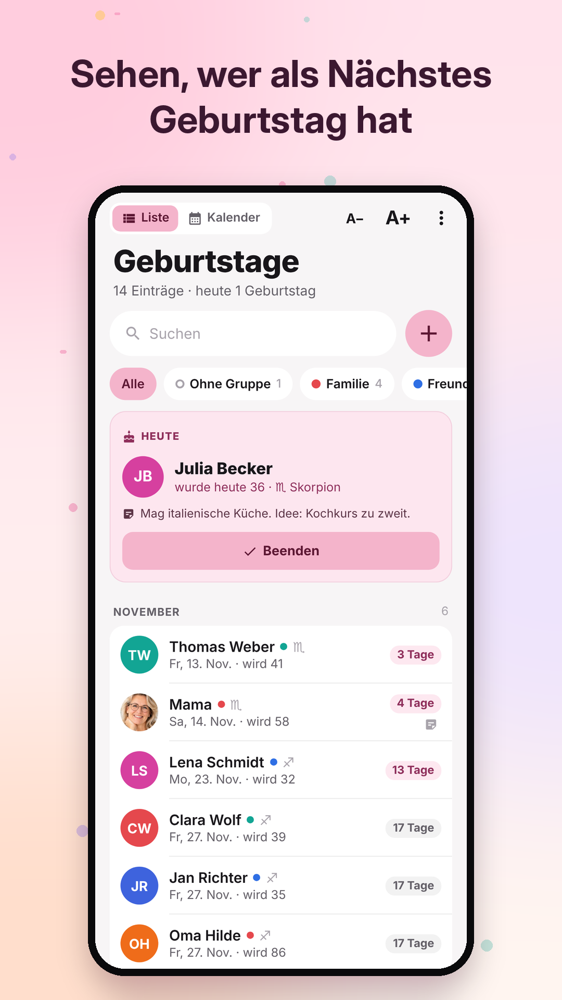
  
  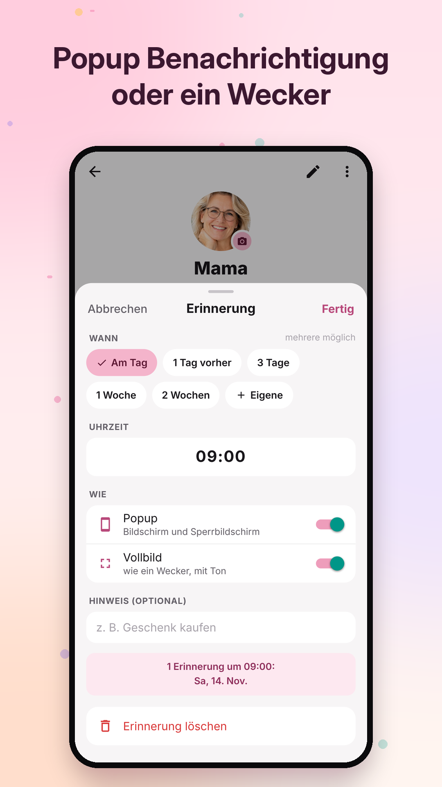
  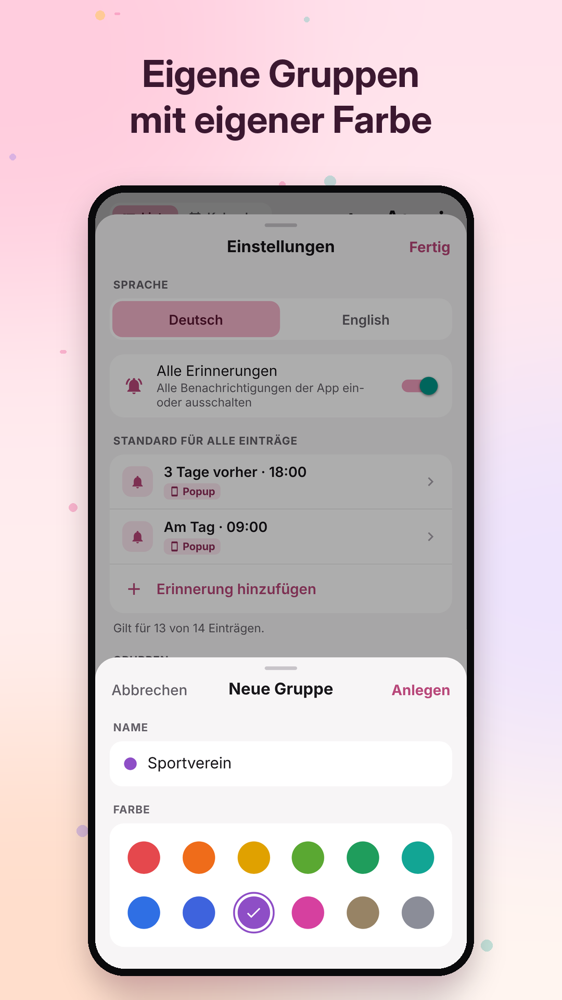
</p>

<p align="center">
  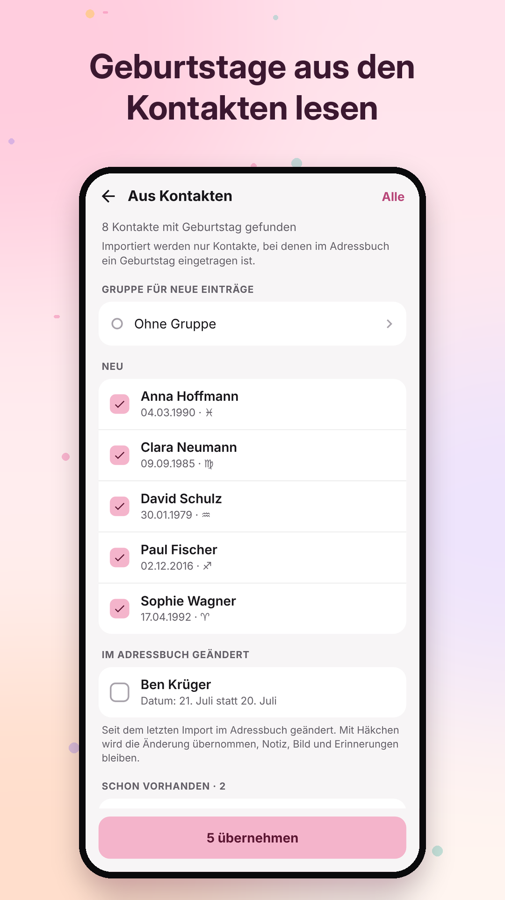
  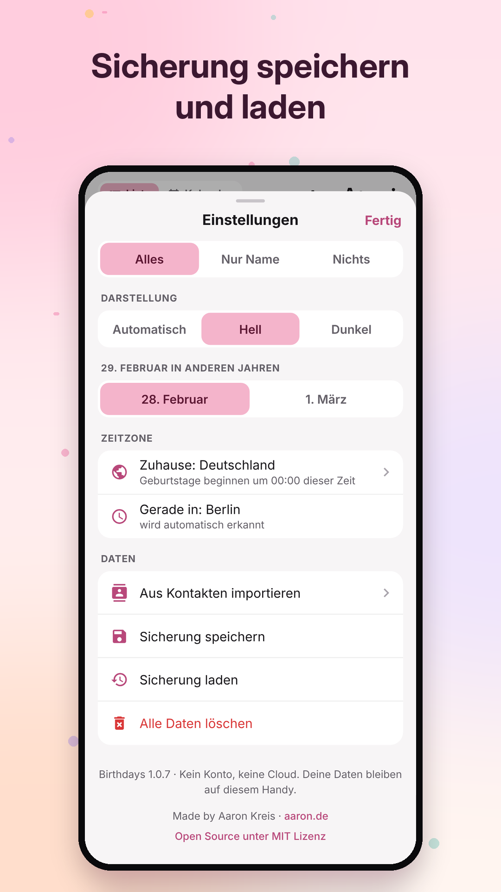
  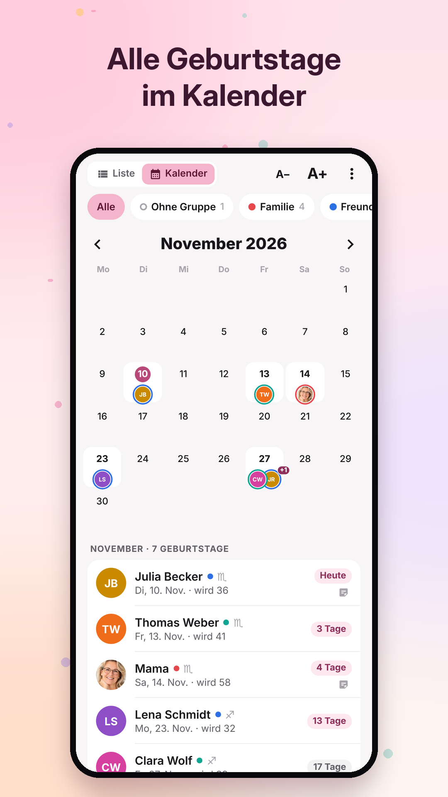
  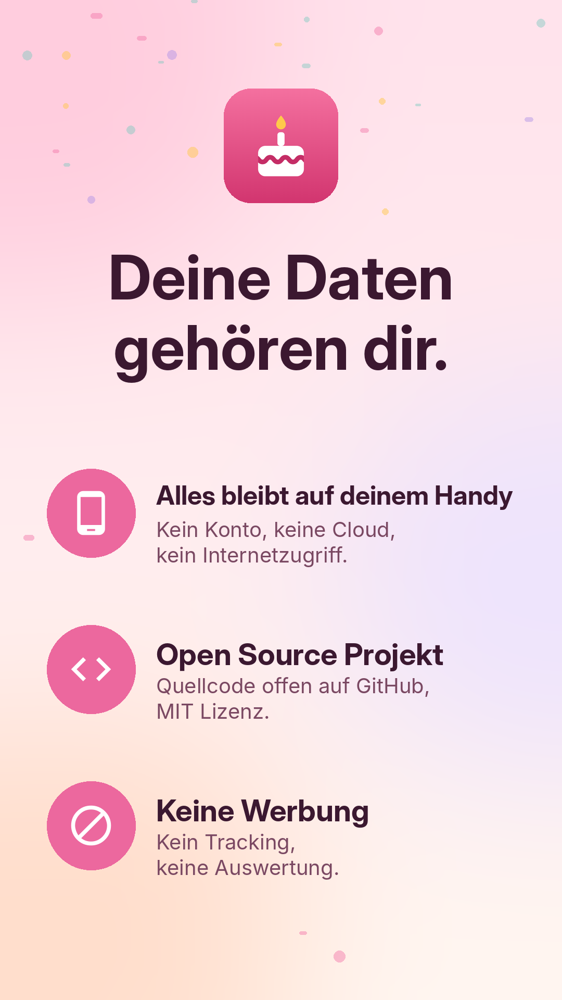
</p>

### Über die App

Birthdays speichert die Geburtstage deiner Freunde und erinnert dich rechtzeitig. Jeder Eintrag hat Name, Geburtstag (das Jahr ist freiwillig), eine Notiz, ein Bild und eigene Erinnerungen. Alter und Sternzeichen stehen überall dabei. Alle Daten bleiben in einer Datenbank auf dem Handy. Die App darf nicht ins Internet.

### Funktionen

- **Startseite:** Wer heute Geburtstag hat, steht oben in einer Karte. Bei mehreren wischt man die Karten oder tippt auf die Pfeile, „1 / 3“ und die Punkte zeigen die Stelle. Darunter folgen alle Einträge nach Monaten, beginnend beim nächsten Geburtstag, mit Tagen bis dahin, kommendem Alter und Sternzeichen.
- **Kalender:** Oben links wechselt man zwischen Liste und Kalender, die App merkt sich die Wahl. Der Kalender zeigt den Monat, jeder Tag mit Geburtstag trägt bis zu zwei Bilder mit einem Ring in der Farbe der Gruppe, ab drei Personen „+1“. Darunter stehen die Geburtstage des Monats. Ein angetippter Tag zeigt nur seine Geburtstage, ein leerer Tag bietet „Eintrag an diesem Tag anlegen“. Der Monatsname öffnet das ganze Jahr, Geburtstage sind dort farbige Punkte, bei mehreren Gruppen geteilt. Wischen oder die Pfeile blättern. Die Gruppenfilter gelten auch hier.
- **Beenden:** „Beenden“ auf der Karte, in der Benachrichtigung oder im Vollbild hakt die Person für heute ab. Für sie kommt heute keine Erinnerung mehr. Das lässt sich nicht zurücknehmen.
- **Neuer Eintrag:** Name, Geburtstag mit Zifferntastatur, die von selbst ins nächste Feld springt, Jahr freiwillig („89“ wird 1989), Vorschau mit Wochentag, Abstand, Alter und Sternzeichen, Notiz und Art der Erinnerung.
- **Eintrag:** Alter, Sternzeichen, Wochentag der Geburt, Notiz (speichert automatisch), Bild aus Galerie, Kamera oder Kontakt, und die Erinnerungen.
- **Erinnerungen:** je Eintrag „Standard“ (aus den Einstellungen), „Eigene“ oder „Keine“. Mehrere Abstände lassen sich gleichzeitig wählen (am Tag, 1 Tag, 3 Tage, 1 Woche, 2 Wochen oder ein eigener Abstand in Tagen, Wochen oder Monaten). Jede Erinnerung hat Uhrzeit, Popup und/oder Vollbild und einen freiwilligen kurzen Hinweis wie „Geschenk kaufen“. Neue Erinnerungen starten nur mit Popup.
- **Popup und Vollbild:** Das Popup erscheint auch auf dem Sperrbildschirm, mit „Beenden“ und „In 1 Std.“ (vor dem Tag: „Beenden“ und „Morgen“). Das Vollbild erscheint wie ein Wecker über dem Sperrbildschirm, mit Ton, bis man reagiert. Auf dem Sperrbildschirm zeigt eine Benachrichtigung alles, nur den Namen („Nur Name“) oder keinen Namen („Nichts“, dann steht dort nur „Geburtstag heute“ oder „Bald ein Geburtstag“).
- **Pause:** „Alle Erinnerungen“ in den Einstellungen pausiert alles, ohne etwas zu löschen. Die Startseite zeigt dann einen Hinweis, der sich schließen lässt.
- **Zeitzonen:** Ein Geburtstag dauert von 00:00 bis 24:00 „Zuhause“ (oder in der Zeitzone der Person). Wo das Handy gerade ist, spielt keine Rolle. Unterwegs zeigt die Karte beide Uhrzeiten. In Sydney heißt sie „Beginnt gleich“, bis der Geburtstag in Deutschland begonnen hat. Erinnerungen am Tag kommen zur eingestellten Uhrzeit der Person, nachts (22 bis 7 Uhr) um 07:00 bei dir. Vorab-Erinnerungen kommen zu deiner Ortszeit. Zeitzonenwechsel, Zeitumstellung, eine verstellte Uhr und ein Neustart planen die Erinnerungen neu, und eine Erinnerung, über die die Uhr beim Flug gesprungen ist, kommt sofort, solange der Geburtstag noch läuft.
- **Gruppen:** etwa Familie, Freunde oder Arbeit, jede mit einer von 12 Farben. Jeder Eintrag gehört zu genau einer Gruppe: zur festen Gruppe „Ohne Gruppe“ oder zu einer eigenen. Chips unter der Suche filtern die Startseite, „Alle“ zeigt alle, und ein farbiger Punkt hinter dem Namen zeigt die Gruppe. Die gewählte Gruppe bleibt beim nächsten Öffnen erhalten, und + legt neue Einträge gleich in ihr an. Gruppen ordnen und filtern nur, die Erinnerungen hängen nicht von ihnen ab. Nach der Installation gibt es schon die Gruppen Ohne Gruppe, Familie, Freunde und Arbeit (auf englischen Handys No group, Family, Friends, Work). Neue Einträge und importierte Kontakte kommen zu „Ohne Gruppe“, solange keine andere Gruppe gewählt ist. Angelegt, umbenannt, sortiert und gelöscht werden Gruppen in den Einstellungen. „Ohne Gruppe“ lässt sich nur verschieben, nicht umbenennen und nicht löschen. Beim Löschen einer Gruppe bleiben ihre Einträge erhalten und gehören danach zu „Ohne Gruppe“.
- **Suche:** in Namen und Notizen, ohne Rücksicht auf Groß und Klein und Umlaute. Ein Monatsname zeigt alle Geburtstage in diesem Monat.
- **Aus Kontakten importieren:** liest die Geburtstage aus den Android-Kontakten, beliebig oft. Importiert werden nur Kontakte mit Geburtstag. Ein erneuter Import erkennt Personen an der Kennung des Kontakts (und ersatzweise an Name und Geburtstag, weil Android Kennungen manchmal neu vergibt), deshalb entsteht nichts doppelt. Was sich seit dem letzten Import im Adressbuch geändert hat (Name oder Datum), steht in einem eigenen Abschnitt und wird nur mit Häkchen übernommen. Änderungen in der App bleiben.
- **29. Februar:** in anderen Jahren am 28. Februar oder am 1. März.
- **Deutsch und Englisch:** Englisch nutzt die Datumsreihenfolge der Region des Handys (USA: „Sat, Nov 7“, Großbritannien und Australien: „Sat 7 Nov“) und die 12- oder 24-Stunden-Einstellung von Android.
- **Einstellungen:** Sprache, Erinnerungen, Standard-Erinnerungen, Gruppen, Sperrbildschirm, Darstellung, 29. Februar, Zeitzone Zuhause, Import, Sicherung speichern und laden (mit Bildern), alle Daten löschen.

### Berechtigungen

Die App fragt jede Erlaubnis erst, wenn sie gebraucht wird:

- **Benachrichtigungen** für Popups (ab Android 13).
- **Genaue Uhrzeit**, damit Erinnerungen pünktlich kommen. Ab Android 13 erlaubt man das einmal in den Einstellungen, die App führt dorthin.
- **Start nach dem Einschalten**, um die Erinnerungen neu zu planen.
- **Vollbild** über dem Sperrbildschirm, nur für Erinnerungen mit Vollbild. Ab Android 14 fragt Android einmal nach.
- **Akku-Optimierung aus** (freiwillig, wichtig bei Samsung und Xiaomi). Die App öffnet die Liste der Apps in den Android-Einstellungen, dort Birthdays auswählen.
- **Kontakte** nur beim Import oder beim Bild aus einem Kontakt.
- **Kamera** nur beim Fotografieren.
- **Vibration** für das Vollbild.

Kein Internet, keine Werbung, kein Tracking, keine Auswertung. Die automatische Android-Sicherung in Googles Cloud ist abgeschaltet (`allowBackup: false`).

### APK installieren

1. Die Datei aufs Handy kopieren (USB-Kabel, oder per Mail oder Messenger an sich selbst).
2. Auf dem Handy in der Dateien-App antippen.
3. Android fragt, ob die Installation aus dieser Quelle erlaubt sein soll. Einmal erlauben.
4. Installieren. Die App erscheint als „Birthdays“ mit rosa Symbol.

Die APK läuft auf Handys mit 64-Bit-Prozessor (arm64) ab Android 8.

### Eigene APK bauen

```
bash scripts/build-apk.sh
```

Läuft unter Linux oder WSL mit Node.js ab 20 und Java 17 bis 21. Der Signierschlüssel liegt in `signing/` (steht in `.gitignore`). Gut sichern: Android installiert ein Update nur, wenn es mit demselben Schlüssel signiert ist. Vor einem Update in `app.json` `version` und `versionCode` erhöhen.

Für Google Play baut `bash scripts/build-apk.sh --play` statt der APK ein App-Bundle (`aab/Birthdays-<Version>.aab`). Google Play signiert die App mit einem eigenen Schlüssel. Deshalb lassen sich die Play-Version und die APKs von GitHub nicht gegenseitig aktualisieren: Wer wechselt, muss die App vorher deinstallieren.

### Entwickeln

```
npm install
npm test
npm run typecheck
```

| Ordner | Inhalt |
|---|---|
| `src/domain/` | Datenmodell, Kalender, Zeitzonen, Zeitplan, Sternzeichen, Datumsformate (mit Tests) |
| `src/data/` | Speicher: SQLite auf dem Handy, Arbeitsspeicher für Tests |
| `src/store/` | BirthdayStore: der einzige Weg, Daten zu ändern, Sicherung (mit Tests) |
| `src/ui/` | Bildschirme, alle Texte auf Deutsch und Englisch in `i18n.ts` |
| `modules/birthday-alarms/` | Android Modul: Wecker, Benachrichtigungen, Vollbild, Neustart und Zeitzonenwechsel |
| `modules/keyboard-language/` | Sprachhinweis für die Tastatur (aus My Notes) |

Die Regeln, wann eine Erinnerung kommt, gibt es zweimal: in `src/domain/schedule.ts` (Anzeige, getestet) und in `modules/birthday-alarms/.../Planner.kt` (Wecker). Eine Änderung an der einen Stelle braucht dieselbe Änderung an der anderen.

### Lizenz

Birthdays ist Open Source unter der MIT Lizenz, siehe [LICENSE](LICENSE).
